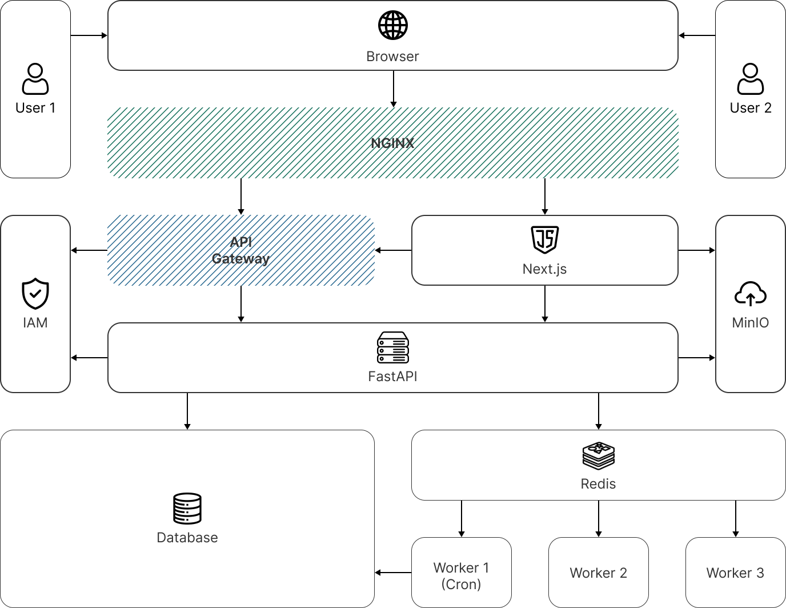

# Sievers Market Backend
RESTful B2B агромаркетплейс для автоматизации торгово-закупочных процессов в АПК, реализованный на FastAPI
с применением принципов Domain-Driven Design и Clean Architecture.

**Витрина:** [market.sievers.kz](https://market.sievers.kz) (Next.js, репозиторий [sievers-market-frontend](https://github.com/sievers-kz/sievers-market-frontend)) работает поверх этого API.

**Живое API:**
| Окружение | Scalar | Swagger UI |
|---|---|---|
| production | [api.market.sievers.kz/scalar](https://api.market.sievers.kz/scalar) | [api.market.sievers.kz/docs](https://api.market.sievers.kz/docs) |
| staging | [api-test.market.sievers.kz/scalar](https://api-test.market.sievers.kz/scalar) | [api-test.market.sievers.kz/docs](https://api-test.market.sievers.kz/docs) |

## Целевая архитектурная схема
<picture>
  <source media="(prefers-color-scheme: dark)" srcset="docs/assets/architecture-schema-dark.png" width="688">
  
</picture>

Представленная целевая архитектура отражает конфигурацию системы и описывает следующий технический флоу:
Входящий запрос поступает через NGINX, который выступает reverse proxy и терминирует SSL.
Далее запрос маршрутизируется либо на Next.js для рендеринга фронтенда, либо на API Gateway,
который обеспечивает роутинг и авторизацию через IAM. Прошедший проверку запрос передаётся в FastAPI,
где сосредоточена бизнес-логика. Для асинхронных операций FastAPI помещает задачи в Redis,
откуда их подхватывают специализированные воркеры - для отправки email, ресайза изображений и выполнения cron-задач.
Медиафайлы хранятся в MinIO, персистентные данные - в PostgreSQL.

### Что из схемы реализовано в этом репозитории
| Реализовано | Вне этого репозитория или в планах |
|---|---|
| Модульный монолит на FastAPI с изолированными bounded context'ами | NGINX, SSL и деплой: репозиторий [sievers-infra](https://github.com/sievers-kz/sievers-infra) |
| PostgreSQL (SQLAlchemy async, миграции Alembic) | API Gateway и отдельный IAM-сервис: сейчас IAM это контекст `iam` внутри монолита |
| Redis и воркер ARQ: письма с кодами подтверждения, проверка организации в реестре налогоплательщиков с повторами | Ресайз изображений и cron-задачи: воркер пока их не выполняет |
| MinIO: загрузка файлов по presigned URL | |
| Meilisearch: поиск и фильтры объявлений по атрибутам | |
| Resend (письма), Sentry (ошибки) | |

## Модули
Код лежит в `src/core/`. Каждый контекст разделён на слои `domain`, `application`, `infrastructure`, `presentation`;
зависимости направлены внутрь. `catalog` и `references` это справочные контексты и содержат только инфраструктуру и презентацию.

| Контекст | За что отвечает |
|---|---|
| `iam` | Регистрация, подтверждение почты по OTP, вход, выход, обновление токена, смена и сброс пароля и почты. Для веб-клиента (`X-Client-Type: web`) токены отдаются в httpOnly cookie |
| `customer` | Аккаунт покупателя и его организации: добавление по ИИН/БИН, проверка в реестре налогоплательщиков, профиль организации (название магазина, контакты) |
| `listing` | Объявления: создание от имени организации, смена цены, описания, локации и атрибутов, активация, архив, поиск |
| `catalog` | Дерево категорий и подкатегорий, определения атрибутов |
| `references` | Справочники: бренды, города, страны, цвета |
| `media` | Загрузка файлов: выдача presigned URL для MinIO и подтверждение загрузки |
| `admin` | Создание администраторов и выдача им прав |
| `shared` | Базовый Unit of Work, обобщённые репозитории, безопасность, интеграции (Redis, Meilisearch, почта) |

## Архитектурные решения
Решения оформлены как ADR в [`docs/adr`](docs/adr): что было, какие альтернативы отвергнуты и чем это обернулось.

| ADR | Решение |
|---|---|
| [001](docs/adr/001-unit-of-work-pattern.md) | Unit of Work на каждый bounded context: транзакциями управляет контекстный менеджер, а не use case и репозитории. Так устранено «заражение» ORM-сессии после ошибок БД |
| [002](docs/adr/002-relational-schema-jsonb-values.md) | Конфигурация атрибутов лежит в реляционных таблицах, значения, введённые пользователем, в JSONB (`listings.attributes`). EAV и схема в JSONB отвергнуты |
| [003](docs/adr/003-role-by-existence.md) | Роль определяется существованием записи профиля, а не полем в `accounts`. IAM не знает о бизнес-ролях |
| [004](docs/adr/004-inter-context-communication.md) | Контексты общаются через публичные сервисы уровня Application, без доступа к чужим репозиториям. Брокер сообщений отложен |
| [005](docs/adr/005-arq-background-tasks.md) | Фоновые задачи на ARQ поверх уже имеющегося Redis вместо Celery и FastAPI Background Tasks |
| [006](docs/adr/006-web-framework-fastapi.md) | FastAPI вместо Django: архитектурная свобода и нативный asyncio |
| [007](docs/adr/007-b2b-participants-model.md) | Строгая B2B-модель: продавать могут только ИП и юридические лица, проверенные по БИН/ИИН |

> **Актуальность.** После перехода на организации (PR #226 и #227) роли `customer` и `vendor` удалены: в системе один аккаунт
> покупателя, у которого может быть несколько организаций, а объявления подаются от имени организации. ADR 003, 004 и 007
> написаны для прежней модели с отдельным контекстом `vendor` и пока не обновлены. Идея B2B (продавец это проверенное
> юрлицо или ИП) сохранилась, но реализуется через `Organization`. Диаграмма [`docs/diagrams/registration-flow.md`](docs/diagrams/registration-flow.md)
> тоже показывает прежний онбординг с ролями.

## Быстрый старт
Для удобства управления Docker-окружением проект использует Makefile, который абстрагирует типовые docker-compose
команды в короткие алиасы. Команды Make представлены в таблице ниже.

    Примечание: убедитесь, что на вашей машине установлены Docker и Docker Compose.

| Команда | Описание |
|---------|----------|
| `make up` | Сборка образов и запуск всех сервисов |
| `make build` | Только сборка образов без запуска |
| `make start` | Запуск ранее собранных контейнеров |
| `make stop` | Остановка всех сервисов |
| `make destroy` | Остановка и удаление всех volumes |
| `make logs` | Логи приложения в реальном времени |
| `make restart` | Перезапуск контейнера приложения |
| `make shell` | Bash внутри контейнера приложения |
| `make db` | Подключение к PostgreSQL через psql |
| `make cache` | Подключение к Redis через redis-cli |
| `make ci` | Полный CI пайплайн в изолированном окружении |

### 1. Клонирование репозитория
Склонируйте проект и перейдите в его корневую директорию:
```bash
> git clone https://github.com/sievers-kz/sievers-market-backend
> cd sievers-market-backend
```

### 2. Настройка переменных окружения
Создайте локальные файлы конфигурации на основе предоставленных шаблонов и заполните их вашими секретами/ключами (БД, Redis, интеграции):
```bash
> cp .env.example .env
> cp .env.test.example .env.test
```

### 3. Сборка и запуск инфраструктуры
Запустите автоматическую сборку и старт всех контейнеров (FastAPI, PostgreSQL, Redis, MinIO) одной командой:
```bash
> make up
```

### 4. Документация API и интерактивная песочница
После успешного запуска бэкенд будет доступен локально. Вы можете протестировать эндпоинты через интерактивную документацию:
* **Scalar API Reference:** `http://localhost:8000/scalar`
* **Swagger UI:** `http://localhost:8000/docs`

### 5. Остановка проекта
Для временной остановки контейнеров без потери данных в базе используйте:
```bash
> make stop
```

## Тестирование

Проект покрыт интеграционными и юнит-тестами с использованием `pytest` и `pytest-asyncio`. Все тесты выполняются
в изолированном тестовом контейнере `sut` с использованием выделенной базы данных из конфигурации `.env.test`.

### Комплексная проверка перед коммитом (CI Pipeline)
Перед отправкой кода в удаленный репозиторий рекомендуется запустить полную локальную имитацию CI-пайплайна:
```bash
> make ci
```
*Команда автоматически уничтожит старые тестовые вольюмы, поднимет чистые сервисы (PostgreSQL, Redis, MinIO),
дождется их полной готовности по `healthcheck`, накатит миграции Alembic, прогонит тесты и полностью
ликвидирует за собой окружение, вернув финальный статус-код.*

## CI/CD
| Workflow | Когда запускается | Что делает |
|---|---|---|
| `ci.yml` | pull request в `main` и `development` | Сначала линтеры через `pre-commit` (проверки файлов, isort, black, flake8), затем `make ci`: тесты в изолированном окружении |
| `cd.yml` | push в `main` (production) и `development` (staging) | Собирает Docker-образ, публикует в GHCR с тегом `production-<sha>` или `staging-<sha>` и запускает деплой в репозитории `sievers-infra` |
| `release-please.yml` | push в `main` | Ведёт версии и changelog по conventional commits |

Тот же набор проверок доступен локально: `pre-commit run --all-files` и `make ci`. Хук `make ci` настроен на стадию `pre-push`.

## Связанные репозитории
- [`sievers-market-frontend`](https://github.com/sievers-kz/sievers-market-frontend): витрина на Next.js, [market.sievers.kz](https://market.sievers.kz).
- [`sievers-infra`](https://github.com/sievers-kz/sievers-infra): конфигурация nginx, Docker Compose и деплой для staging и production.
